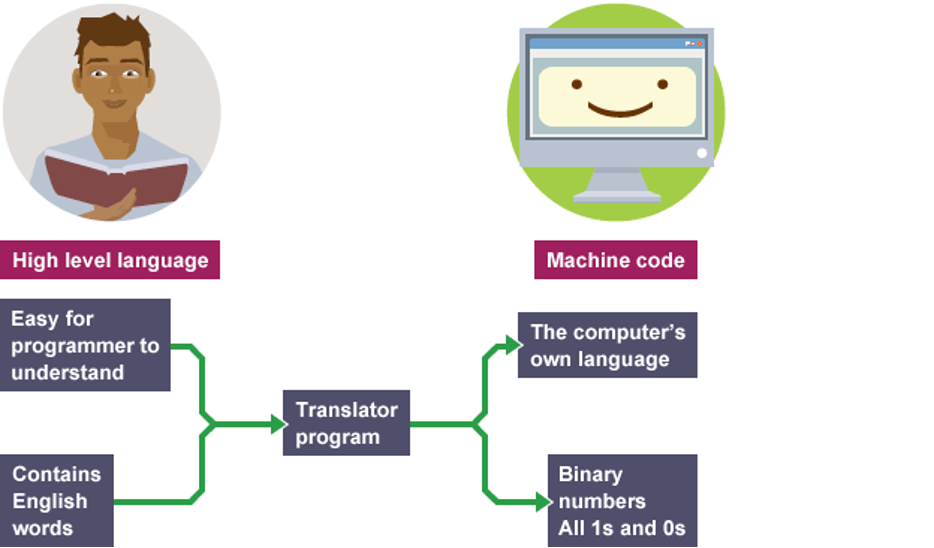
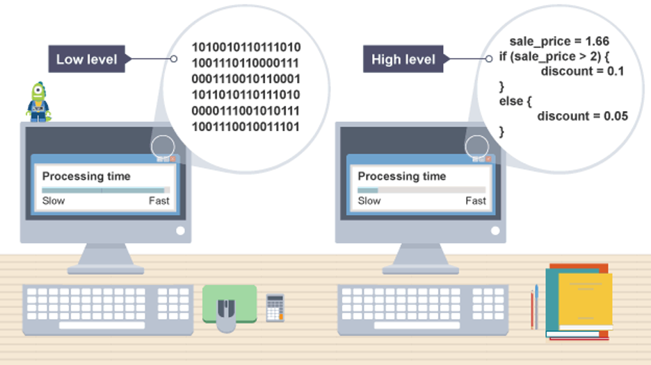
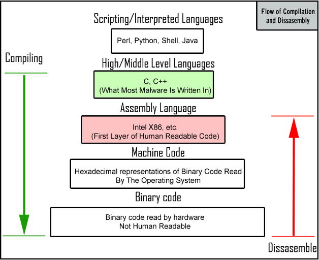
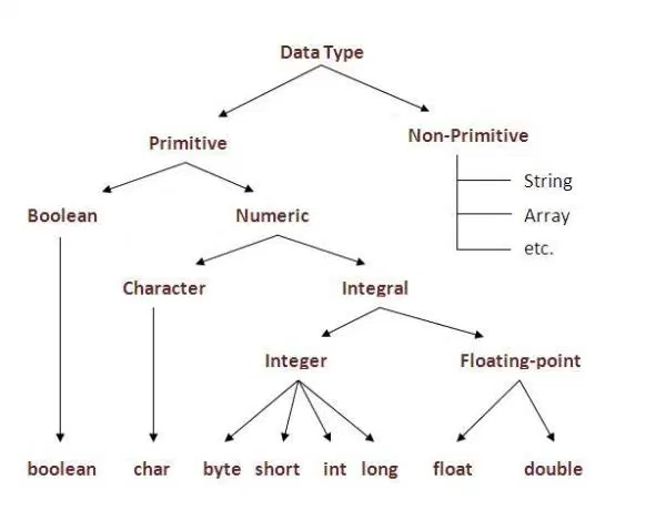
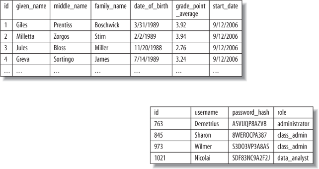
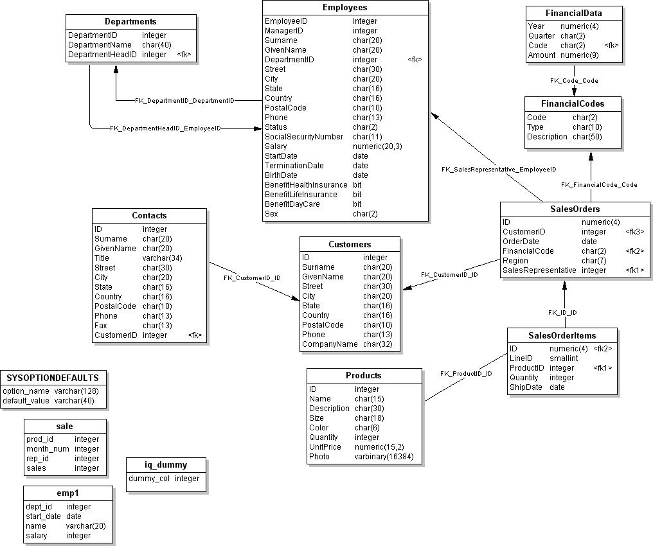
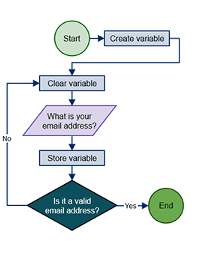
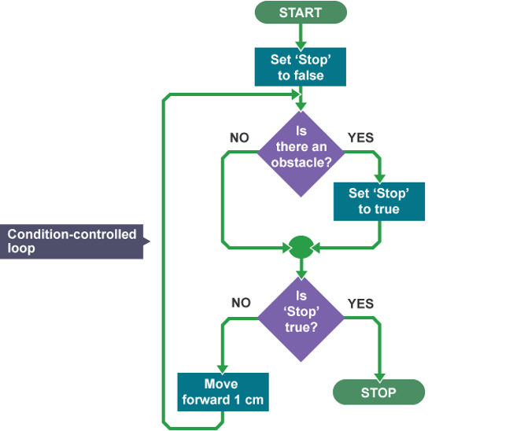

## I dag

1. **Skal vi stadig kode?** Om AI og kode.
2. **Systemet er lag.** Kernighan kap. 6.
3. **Workshop:** I får en bestilling på et "IT-system" fra mig.
4. **At designe en funktion.** Downey kap. 4, 5 og 6.
5. **Paradigmer.** Den samme opgave løst på tre måder.
6. **Workshop-øvelser.**

::: {.fragment}
I skriver ikke færdig kode i dag. I skriver **grænseflader**: hvad hver funktion skal hedde, hvad den får ind, og hvad den giver tilbage.
:::

## Litteraturen, og hvor den bruges

| Kapitel | Bruges til |
|---|---|
| **Downey kap. 4:** *Functions and Interfaces* | Grænseflade og implementation, docstrings, præ- og postbetingelser, udviklingsplanen |
| **Downey kap. 5:** *Conditionals and Recursion* | Booleske udtryk, kædede betingelser, rekursion og base case |
| **Downey kap. 6:** *Return Values* | `return` og `print`, rene funktioner, inkrementel udvikling, validering af input |
| **Kernighan kap. 6:** *Software Systems* | Systemer som lag, styresystem, filsystem, grænseflader |
| **Kernighan kap. 7:** *Learning to Program* | Hvorfor man skal kunne læse kode, også når man ikke skriver den selv |

# Skal vi stadig kode?

Om AI, og om hvad det kræver at vedligeholde et system.

## {background-image="billeder/jensen.png" background-size="contain" background-color="#ffffff"}


## Et system bygget med prompts

Forestil jer, at vi har bygget et system med **prompts**. Vi har forbedret det lidt ad gangen, prompt for prompt, indtil det virkede.

```
> lav et system der ...
> tilføj X ...
> tilføj Y ...
```

Det kører. Vi bruger det i et par år. Så opstår der et nyt behov.

::: {.incremental}
- Kan vi vende tilbage til koden og tilføje det, **uden at kunne kode**?
- Kan vi overhovedet **genskabe systemet 1:1**, selv hvis vi i et øjeblik af klarsyn gemte alle vores prompts?
:::

::: {.fragment}
*Min personlige og* **for nuværende** *erfaring siger nej. Men hvad tænker I?*
:::

## De blinde leder de blinde

> Jeg ville ikke oversætte en tekst til kinesisk med AI og derefter helt ukritisk sende den til udgivelse i Kina.

**Et læringsperspektiv:** tænk på, hvad Words stavekontrol har gjort for skrivefærdigheder.

::: {.fragment}
Det er ikke et argument mod at bruge værktøjet. Det er Kernighans argument (kap. 7): **man skal kunne læse koden**, også den, man ikke selv har skrevet, hvis man skal arbejde med IT.
:::

# Systemet er lag

Hvert lag bruger laget nedenunder uden at vide, hvordan det virker indeni.

## Software er lag

:::: {.to-kol}
::: {.kol}
Det, vi kalder "en computer", er **lag af software** oven på hinanden (Kernighan, kap. 6).

- **Applikationerne:** browseren, VS Code, "programmerne".
- **Filsystemet** får en disk med nummererede blokke til at ligne mapper og filer.
- **Styresystemet** deler processoren, hukommelsen og disken ud mellem programmerne.
:::

::: {.figur figur="lag" retur="nej" lag="Applikationerne|browseren, VS Code, jeres egne programmer;Filsystemet|mapper og filer i stedet for nummererede blokke;Styresystemet|deler processor, hukommelse og disk ud;Hardwaren|processor, hukommelse, disk" start="Fire lag. Hvert lag bruger kun laget lige under."}
:::
::::

## Hvad sker der, når I skriver `ls`?

Da I skrev `ls` i lektion 1, spurgte I ikke disken. I spurgte et lag, der spurgte et lag, der spurgte disken. Tryk *Næste trin*.

::: {.figur figur="lag" retur="ja" lag="Terminalen|et vindue, der kan vise tekst. Den kan ikke læse en disk, så den giver linjen videre til skallen (zsh på Mac, PowerShell på Windows);Skallen|finder programmet ls og beder styresystemet om at starte det;ls|spørger styresystemet: giv mig indholdet af den her mappe. Det kaldes et systemkald. ls har ikke lov til at røre disken selv;Styresystemet|tjekker først, om I må læse mappen. Så spørger det filsystemet;Filsystemet|ved, at mappen står i blok 4711;Driveren|oversætter 'giv mig blok 4711' til det, netop denne disk forstår;SSD'ens controller|ved, hvilke fysiske celler blok 4711 ligger i lige nu" start="I skriver ls og trykker Enter." slut="Svaret kommer tilbage gennem de samme lag. ls sorterer navnene og skriver dem ud. Terminalen tegner dem som pixels."}
:::

## Fem lag og et systemkald

Svaret kommer tilbage gennem de samme lag. `ls` sorterer navnene og skriver dem ud. Terminalen tegner dem som pixels.

- Fem lag og et systemkald, bare for at se, hvad der ligger i en mappe.
- Og `ls` ved stadig ikke, om jeres computer har en SSD, en gammel harddisk eller et netværksdrev. **Det behøver den ikke.**

## {.udsagn}

Det er præcis det, I skal gøre om lidt, i det små.

Vi skriver `andel()` sådan, at den, der bruger den, **ikke behøver vide, hvordan den regner**.

## Abstraktion (1): fra menneskesprog til maskinkode

{.nostretch fig-align="left" height="430px"}

## Abstraktion (2): lavt og højt niveau

{.nostretch fig-align="left" height="430px"}

## Abstraktion (3): sprogene i lag

{.nostretch fig-align="left" height="440px"}

## Grænsefladen mellem lagene

Et lag kan skiftes ud, uden at de andre opdager det, **så længe grænsefladen er den samme**. Derfor kan en SSD erstatte en harddisk, uden at jeres tekstbehandling skal skrives om.

- Downey kalder det samme for en **interface**, bare inde i ét program: *hvordan* en funktion bruges, adskilt fra *hvordan* den virker.
- Det er dagens opgave. I skal lægge grænsefladerne fast i barometeret, før nogen skriver en eneste linje, der regner på noget.

## Open source

Kernighan bruger open source som eksempel på, hvad der sker, når koden er åben: andre kan **læse** den, **finde fejl** i den og **bygge videre** på den.

I gjorde præcis det sidste gang. I forkede mit repository, ændrede i kopien og sendte ændringen tilbage. Sådan foregår meget softwareudvikling.

## Det samme princip gælder inde i en Python-funktion

:::: {.to-kol}
::: {.kol}
En Python-funktion er også en [grænseflade]{.ord}.

- Forestil jer en funktion, der beregner gennemsnittet af en liste med tal. Grænsefladen fortæller, **hvordan vi kalder den**, hvilke argumenter den forventer, og hvad den returnerer.
- Vi behøver ikke kende koden indeni. Ændrer vi beregningen indeni, virker resten af programmet stadig, så længe grænsefladen og den forventede adfærd er den samme.
:::

::: {.figur figur="funktion" navn="gennemsnit" ind="en liste med tal" ud="ét tal"}
:::
::::

::: {.fragment}
**Dagens opgave:** I aftaler grænsefladerne i jeres barometer. Hvilke oplysninger modtager hvert lag? Hvad skal det levere videre? Og hvad skal laget gøre? Koden, der regner, kommer senere på kurset.
:::

# Computationel tænkning

Det, man gør, før man skriver kode.

## Fire greb i computationel tænkning

::::: {.trin-kort}
:::: {.kol}
Dekomposition

Del det store problem op i dele, der kan bygges hver for sig.
::::

:::: {.fragment}
Mønstergenkendelse

Find det, der ligner noget, I har set før.
::::

:::: {.fragment}
[Abstraktion]{.ord}

Smid alt det væk, der ikke betyder noget for opgaven.
::::

:::: {.fragment}
Algoritmedesign

Skriv fremgangsmåden ned, trin for trin, uden huller.
::::
:::::

::: {.fragment}
De fire greb er ikke programmering. **De er det, man gør inden.**
:::

## Data: typer

{.nostretch fig-align="left" height="440px"}

## Data: lagring i tabeller

{.nostretch fig-align="left" height="330px"}

## Data: tabeller, der hænger sammen

{.nostretch fig-align="left" height="440px"}

## Algoritmer: et rutediagram

{.nostretch fig-align="left" height="440px"}

## Algoritmer: en løkke med en betingelse

{.nostretch fig-align="left" height="440px"}

# Workshop: En bestilling fra en kunde

Hvad skal man vide, før man kan bygge noget?

## Bestillingen

> "Jeg har skrevet en rapport om diversitet på danske arbejdspladser. Nu vil jeg gerne have sådan et **online barometer**, hvor en virksomhed kan taste sine egne tal ind og se, hvordan de ligger i forhold til andre. Det skal også kunne bruges til at slå ting op. Kan I ikke bygge det?"

Det er alt, I får. Det skal ligne en (stiliseret) virkelig bestilling fra en kunde, der ikke kender til IT.

::: {.fragment}
**Hvad er der galt med den?** Ikke noget, bortset fra at man ikke kan bygge efter den.
:::

## Øvelse 1: interview kunden

**Første arbejde i gruppen.** Skriv de spørgsmål ned, I vil stille kunden. Prioritér dem, som om I ikke får tid til dem alle.

- Hvad skal brugeren kunne **gøre bagefter**, som de ikke kan i dag?
- Hvem er brugeren egentlig? Er der mere end én slags?
- Hvad skal systemet **ikke** kunne?

**Derefter "interviewer" vi kunden i plenum.**

[10 min]{.timer tid=600}

# At designe en funktion

Først hvad funktionen skal gøre. Så hvordan.

## Grænseflade og implementation

:::: {.to-kol}
::: {.kol}
Downey deler en funktions design i to:

- **Grænsefladen:** hvad funktionen hedder, hvilke parametre den tager, og hvad den skal gøre.
- **Implementationen:** hvordan den gør det.

::: {.fragment}
To funktioner kan have **samme grænseflade** og helt forskellige implementationer. Så kan man skifte det indeni ud uden at røre resten af programmet.
:::
:::

::: {.figur figur="funktion" navn="andel" ind="antal, i_alt" ud="en andel"}
:::
::::

::: {.fragment}
I dag designer I grænseflader. Implementationen kommer senere og må gerne blive skiftet ud undervejs.
:::

## Docstring: grænsefladen skrevet ned {.kodelab}

En **[docstring]{.ord}** er grænsefladen skrevet ned: teksten i tre anførselstegn lige under `def`.

:::: {.proev forslag="Skriv `help(print)` på en ny linje. Hvem har skrevet *den* docstring?"}
```{pyodide}
def andel(antal, i_alt):
    """Beregn en andel af de ansatte.

    antal: heltal, 0 eller derover, ikke større end i_alt
    i_alt: heltal større end 0
    returnerer: et tal mellem 0 og 1
    """
    return antal / i_alt

print(andel(84, 120))
help(andel)
```

::: {.forklaring}
1. {1} `def andel(antal, i_alt):` er grænsefladens første del: navnet og de to parametre.
2. {2-7} Docstringen. Den står mellem tre anførselstegn i hver ende og må fylde flere linjer.
3. {4-6} Hvad hver parameter skal være, og hvad funktionen giver tilbage. Det er **kontrakten**.
4. {8} Implementationen: én linje, der regner andelen ud.
5. {10} Kald funktionen. 84 ud af 120 ansatte.
6. {11} `help(andel)` viser docstringen. Det er sådan, andre finder ud af, hvordan de bruger funktionen.
:::
::::

::: {.lille}
En docstring forklarer **hvad**, ikke hvordan. Downey: har man svært ved at forklare en funktion kort, er grænsefladen sandsynligvis forkert.
:::

## En grænseflade er en kontrakt

:::: {.to-kol .smal-bred}
::: {.kol}
Den, der kalder, lover noget om argumenterne: **præbetingelser**.

Funktionen lover noget om resultatet: **postbetingelser**.
:::

::: {.figur figur="funktion" navn="andel" ind="antal, i_alt" ud="en andel" foer="antal og i_alt er heltal;i_alt er større end 0;antal er ikke større end i_alt" efter="resultatet er et tal mellem 0 og 1"}
:::
::::

## Præ- og postbetingelser i kode {.kodelab}

Funktionen kan selv **tjekke** præbetingelserne, før den regner.

:::: {.proev forslag="Prøv `andel(84.0, 120)`. Hvilken af de tre kontroller slår til?" gaet="Hvad giver det sidste kald, andel(84, 0)?" valg="0|None|En fejl"}
```{pyodide}
def andel(antal, i_alt):
    """Beregn en andel. Returnerer None, hvis tallene ikke giver mening."""
    if not isinstance(antal, int) or not isinstance(i_alt, int):
        print("andel er kun defineret for heltal.")
        return None
    if i_alt <= 0:
        print("Der skal være mindst én ansat.")
        return None
    if antal > i_alt:
        print("Der kan ikke være flere i gruppen end der er ansatte.")
        return None
    return antal / i_alt

print(andel(84, 120))
print(andel(130, 120))
print(andel(84, 0))
```

::: {.forklaring}
1. {2} Docstringen siger, hvad der sker, hvis tallene ikke giver mening: funktionen giver `None`.
2. {3-5} Første kontrol: er begge tal heltal? `isinstance(antal, int)` er sand, hvis `antal` er et heltal. `not` vender svaret om. Er en af dem ikke et heltal, skriver funktionen en besked og giver `None` tilbage.
3. {6-8} Anden kontrol: der skal være mindst én ansat. Ellers ville vi dividere med 0.
4. {9-11} Tredje kontrol: der kan ikke være flere i gruppen end der er ansatte.
5. {12} Kun hvis alle tre kontroller er gået godt, regner funktionen.
6. {14-16} Tre kald: ét gyldigt og to, der bryder hver sin præbetingelse.
:::
::::

::: {.lille}
Downey kalder det **input validation**. Bryder den, der kalder, en præbetingelse, ligger fejlen hos kalderen, ikke i funktionen. Det er værd at vide, når man leder efter en fejl.
:::

# Returværdier

At vise noget og at give noget tilbage er to forskellige ting.

## `print` eller `return`? {.kodelab}

To funktioner, der regner det samme ud. Den ene viser svaret, den anden giver det tilbage.

:::: {.proev forslag="Prøv at regne videre på `a`: skriv `print(a * 100)`. Hvad sker der?" gaet="Hvad står der efter \"vis_andel gav:\"?" valg="0.7|None|En fejl"}
```{pyodide}
def vis_andel(antal, i_alt):
    print(antal / i_alt)

def beregn_andel(antal, i_alt):
    return antal / i_alt

a = vis_andel(84, 120)
print("vis_andel gav:", a)

b = beregn_andel(84, 120)
print("beregn_andel gav:", b)
print("og den kan regnes videre på:", round(b * 100), "procent")
```

::: {.forklaring}
1. {1-2} `vis_andel` **viser** resultatet med `print`, men giver ikke noget tilbage.
2. {4-5} `beregn_andel` **giver resultatet tilbage** med `return`, men viser ingenting.
3. {7} Kaldet skriver 0.7 på skærmen. Men det, der bliver gemt i `a`, er `None`: "ingenting".
4. {8} Det kan ses her.
5. {10} Her bliver 0.7 gemt i `b`, fordi funktionen returnerer.
6. {11-12} Og `b` kan regnes videre på: gang med 100, og rund af med `round()`.
:::
::::

::: {.fragment}
En funktion uden `return` giver `None`. Den kan vise noget på skærmen, men resultatet kan ikke bruges videre. En funktion, der kun regner og returnerer, kaldes en **ren funktion**.
:::

## Booleske funktioner {.kodelab}

En funktion må gerne returnere `True` eller `False`. Så kan en indviklet test få et navn, man kan læse.

:::: {.proev forslag="Ret grænsen i linje 3 til `>= 100`. Hvilke af svarene ændrer sig?"}
```{pyodide}
def er_stor_nok(ansatte):
    """Er arbejdspladsen med i rapportens grundlag?"""
    return ansatte >= 50

print(er_stor_nok(120))
print(er_stor_nok(12))

if er_stor_nok(120):
    print("Med i barometeret")
```

::: {.forklaring}
1. {1} En funktion, der tager antallet af ansatte ind.
2. {2} Docstringen er formuleret som et ja/nej-spørgsmål. Det er en god vane for booleske funktioner.
3. {3} `ansatte >= 50` er allerede `True` eller `False`. Det er dét, der returneres.
4. {5-6} 120 er mindst 50, 12 er ikke.
5. {8-9} Funktionen kan stå direkte efter `if`. Koden læses næsten som en sætning: *hvis arbejdspladsen er stor nok*.
:::
::::

::: {.lille}
Skriv `if er_stor_nok(120):`, ikke `if er_stor_nok(120) == True:`. Sammenligningen er overflødig, for udtrykket **er** allerede sandt eller falsk.
:::

## Inkrementel udvikling (1): en tom funktion, der virker {.kodelab}

Tilføj og test **lidt kode ad gangen**. Start med en funktion, der er færdig, men ikke gør noget endnu.

:::: {.proev}
```{pyodide}
def placering(andel, percentiler):
    """Hvor ligger andelen i fordelingen? Foreløbig: ingen steder."""
    return "ukendt"

percentiler = {"p25": 0.30, "p50": 0.45, "p75": 0.60}
print(placering(0.42, percentiler))
```

::: {.forklaring}
1. {1} Grænsefladen: navnet `placering` og to parametre, en andel og nogle percentiler.
2. {2} Docstringen siger ærligt, at funktionen ikke kan noget endnu.
3. {3} En midlertidig returværdi. Funktionen giver altid `"ukendt"` tilbage.
4. {5} Percentilerne fra rapporten, gemt i en dictionary: et navn pr. tal.
5. {6} Funktionen kan kaldes allerede nu, og resten af programmet kan bygges op omkring den.
:::
::::

::: {.fragment}
Den gør ingenting, men den **kan kaldes**, og den returnerer noget. Nu kan resten bygges op omkring den, mens den stadig er tom.
:::

## Hvor ligger en andel?

:::: {.to-kol .smal-bred}
::: {.kol}
Funktionen skal give `"lav"`, `"middel"` eller `"hoej"` ud fra, hvor andelen ligger i forhold til percentilerne.

Træk i skyderen, og se, hvilken betingelse der afgør svaret.
:::

::: {.figur figur="percentil" p25="0.30" p50="0.45" p75="0.60" andel="0.42" navn="andel"}
:::
::::

## Inkrementel udvikling (2): implementationen {.kodelab}

Nu udfylder vi implementationen. Grænsefladen er uændret.

:::: {.proev forslag="Tilføj `0.30` til listen i linje 15. Bliver den \"lav\" eller \"middel\"? Hvorfor?"}
```{pyodide}
def placering(andel, percentiler):
    """Hvor ligger andelen i fordelingen?

    andel: tal mellem 0 og 1
    percentiler: dictionary med nøglerne p25, p50 og p75
    returnerer: "lav", "middel" eller "hoej"
    """
    if andel < percentiler["p25"]:
        return "lav"
    elif andel < percentiler["p75"]:
        return "middel"
    else:
        return "hoej"

for tal in [0.20, 0.42, 0.75]:
    print(tal, "->", placering(tal, percentiler))
```

::: {.forklaring}
1. {1-7} Samme grænseflade som før, nu med en docstring, der siger præcis, hvad der går ind og ud.
2. {8-9} Er andelen under 25-percentilen, er svaret `"lav"`. `percentiler["p25"]` slår tallet op i dictionaryen.
3. {10-11} Ellers: er den under 75-percentilen, er svaret `"middel"`. Python når kun hertil, hvis den første betingelse var falsk.
4. {12-13} Ellers er svaret `"hoej"`.
5. {15-16} En løkke tester funktionen med tre andele: én i hver zone. `percentiler` blev lavet i cellen med den tomme funktion, så den skal være kørt først.
:::
::::

::: {.lille}
Undervejs havde funktionen `print`-linjer, der viste mellemregningerne. Downey kalder dem **stilladser**: de hjælper, mens man bygger, og fjernes, når det står.
:::

## Kædet eller indlejret?

:::: {.to-kol}
::: {.kol}
**Kædet:** med `elif`

```python
if andel < p25:
    return "lav"
elif andel < p75:
    return "middel"
else:
    return "høj"
```
:::

::: {.kol}
**Indlejret:** `if` inden i `if`

```python
if andel < p25:
    return "lav"
else:
    if andel < p75:
        return "middel"
    else:
        return "høj"
```
:::
::::

De gør det samme. Den venstre er nemmere at læse. **Rækkefølgen betyder noget:** kun den første sande gren kører.

# Paradigmer

Den samme opgave kan organiseres på flere måder.

## Sproget vælger ikke for jer

Et **paradigme** er en måde at organisere kode på. De fleste sprog kan flere.

| Sprog | Paradigmer |
|---|---|
| **Python** | Objektorienteret, procedureorienteret, funktionsorienteret |
| **R** | Funktionsorienteret, procedureorienteret |
| **C** | Procedureorienteret, imperativ |
| **Java** | Objektorienteret, imperativ |
| **JavaScript** | Hændelsesdrevet, funktionsorienteret, objektorienteret |
| **Haskell** | Funktionsorienteret, deklarativ |
| **Prolog** | Logikbaseret, deklarativ |
| **SQL** | Deklarativ, mængdebaseret |

## Objektorienteret programmering

Opgaven løses med **objekter**. Et objekt svarer til en forestilling om noget i virkeligheden. Objekter med samme egenskaber samles i **klasser**.

En vigtig del af paradigmet er at **skjule, hvordan tingene virker indeni**, så implementationen kan ændres, uden at grænsefladen gør det.

*Fem begreber, vi møder i løbet af kurset:*

1. Klasser og objekter
2. Attributter og metoder
3. *Encapsulation*: indkapsling
4. *Inheritance*: nedarvning
5. *Polymorphism*: foranderlighed

## Første forsøg: ni variable {.kodelab}

Tre arbejdspladser, tre variable hver. Det virker.

:::: {.proev}
```{pyodide}
plads1_navn, plads1_ansatte, plads1_kvinder = "Skolen", 120, 84
plads2_navn, plads2_ansatte, plads2_kvinder = "Værket", 240, 31
plads3_navn, plads3_ansatte, plads3_kvinder = "Rådhuset", 95, 58

print(f"{plads1_navn}: {plads1_kvinder / plads1_ansatte:.0%} kvinder")
print(f"{plads2_navn}: {plads2_kvinder / plads2_ansatte:.0%} kvinder")
print(f"{plads3_navn}: {plads3_kvinder / plads3_ansatte:.0%} kvinder")
```

::: {.forklaring}
1. {1-3} Tre oplysninger pr. arbejdsplads: navn, antal ansatte og antal kvinder. Python kan gemme tre værdier på én linje: navnene til venstre og værdierne til højre, i samme rækkefølge.
2. {5-7} Den samme beregning skrevet tre gange. `:.0%` i f-strengen viser tallet som procent uden decimaler.
:::
::::

::: {.fragment}
Forestil jer det samme med **7.225 arbejdspladser**.
:::

## Bedre: én liste af dictionaries {.kodelab}

Hver arbejdsplads bliver én **dictionary**, og alle tre samles i én **liste**.

:::: {.proev forslag="Tilføj en fjerde arbejdsplads i listen. Skal løkken ændres?"}
```{pyodide}
arbejdspladser = [
    {"navn": "Skolen", "ansatte": 120, "kvinder": 84},
    {"navn": "Værket", "ansatte": 240, "kvinder": 31},
    {"navn": "Rådhuset", "ansatte": 95, "kvinder": 58},
]

for plads in arbejdspladser:
    print(f"{plads['navn']}: {plads['kvinder'] / plads['ansatte']:.0%} kvinder")
```

::: {.forklaring}
1. {1-5} En liste (firkantede parenteser) med tre dictionaries (krøllede parenteser). Hver dictionary har de samme tre nøgler.
2. {7} Løkken tager én arbejdsplads ad gangen og kalder den `plads`.
3. {8} `plads['kvinder']` slår værdien op under nøglen `kvinder`. Beregningen står kun ét sted.
:::
::::

::: {.fragment}
Nu er data samlet. Men beregningen ligger stadig i løkken og skal gentages, hver gang nogen får brug for den.
:::

## En klasse er en skabelon

:::: {.to-kol .smal-bred}
::: {.kol}
En **klasse** beskriver, hvad alle arbejdspladser **ved** (attributter) og **kan** (metoder).

Et **objekt** er én bestemt arbejdsplads, lavet ud fra skabelonen, med sine egne værdier.

Tryk *Næste trin*.
:::

::: {.figur figur="klasse" navn="Arbejdsplads" ved="navn,ansatte,kvinder" kan="andel_kvinder()" objekter="Skolen,120,84;Værket,240,31;Rådhuset,95,58"}
:::
::::

## En klasse i kode: data og handling samlet {.kodelab}

Den samme skabelon, skrevet i Python.

:::: {.proev forslag="Lav et objekt for Værket på en ny linje: `vaerket = Arbejdsplads(\"Værket\", 240, 31)`, og kald `vaerket.beskriv()`."}
```{pyodide}
class Arbejdsplads:
    def __init__(self, navn, ansatte, kvinder):
        self.navn = navn
        self.ansatte = ansatte
        self.kvinder = kvinder

    def andel_kvinder(self):
        """Andelen af kvinder blandt de ansatte, som et tal mellem 0 og 1."""
        return self.kvinder / self.ansatte

    def beskriv(self):
        return f"{self.navn}: {self.andel_kvinder():.0%} kvinder"

skolen = Arbejdsplads("Skolen", 120, 84)
print(skolen.beskriv())
print(skolen.ansatte)              # attribut: noget objektet VED
print(skolen.andel_kvinder())      # metode: noget objektet KAN
```

::: {.forklaring}
1. {1} `class Arbejdsplads:` laver en ny klasse. Klassenavne skrives med stort begyndelsesbogstav.
2. {2-5} `__init__` køres, hver gang et nyt objekt laves. `self` er det objekt, der bliver lavet. `self.navn = navn` gemmer værdien *på objektet*.
3. {7-9} En metode: en funktion, der hører til klassen. Den regner på objektets egne tal, `self.kvinder` og `self.ansatte`.
4. {11-12} En metode kan kalde en anden metode på samme objekt.
5. {14} Lav et objekt. Python kalder `__init__` med de tre værdier.
6. {15-17} Brug objektet. `skolen.ansatte` er noget, objektet **ved**. `skolen.andel_kvinder()` er noget, det **kan**.
:::
::::

::: {.lille}
Det er præcis den abstraktion, I laver i øvelse 3: det, arbejdspladsen **ved**, og det, den **kan**.
:::

## Klassen kan sige fra {.kodelab}

Klassen kan også tjekke sine egne præbetingelser, når et objekt bliver lavet.

:::: {.proev forslag="Ret antallet af ansatte i linje 11 til 60. Og prøv så 70 kvinder." gaet="Kiosken har 12 ansatte. Hvad sker der i linje 11?" valg="Kiosken bliver lavet|Python stopper med en fejl|Linjen springes over"}
```{pyodide}
class Arbejdsplads:
    def __init__(self, navn, ansatte, kvinder):
        if ansatte < 50:
            raise ValueError("Barometeret dækker kun arbejdspladser med mindst 50 ansatte")
        if kvinder > ansatte:
            raise ValueError("Der kan ikke være flere kvinder end ansatte")
        self.navn = navn
        self.ansatte = ansatte
        self.kvinder = kvinder

lille = Arbejdsplads("Kiosken", 12, 7)
```

::: {.forklaring}
1. {2} Samme `__init__` som før.
2. {3-4} Er der under 50 ansatte, stopper Python med en fejl. `raise ValueError(...)` laver fejlen, og teksten er beskeden.
3. {5-6} Det samme, hvis der er flere kvinder end ansatte.
4. {7-9} Kun hvis begge kontroller er gået godt, bliver værdierne gemt på objektet.
5. {11} Kiosken har 12 ansatte. Den røde fejlbesked er **meningen**: klassen nægter at lave objektet.
:::
::::

::: {.fragment}
Præbetingelserne fra før håndhæves nu ét sted. Ingen kan lave en `Arbejdsplads`, der bryder reglen fra rapporten. **Det** er indkapsling.
:::

# Øvelsen: design softwaren

Dekomposition, abstraktion og grænseflader, i jeres eget mini-projekt.

## Resten af dagen

I arbejder i **gruppens fork** fra sidste gang. Alt, I laver, skal committes og pushes, inden I går.

| | Øvelse | Hvor det ender |
|---|---|---|
| 2 | Dekomposition | `DESIGN.md` |
| 3 | Hvad er en arbejdsplads? | `DESIGN.md`, afsnittet *Klasserne* |
| 4 | Skriv grænsefladerne | `python/barometer.py` |
| 5 | Få én af dem til at virke | `python/barometer.py` og en notebook |

::: {.lille}
Husk arbejdsgangen fra lektion 3: pull, før I begynder. Én ad gangen i den samme fil.
:::

## Øvelse 2: Dekomposition

Del barometeret op i **fem til otte dele**, der kan bygges hver for sig. For hver del, én sætning: **hvad går ind, og hvad kommer ud?**

- Hvilken del ville I bygge **først**, hvis I kun havde én uge?
- Hvilken del er I mest i tvivl om, at I overhovedet kan bygge?

[15 min]{.timer tid=900}

::: {.fragment}
De to spørgsmål har ofte samme svar. **Man bygger det usikre først**, ikke det nemme.
:::

## Øvelse 3: Hvad er en arbejdsplads?

Skriv i to spalter. [10 min]{.timer tid=600}

:::: {.to-kol}
::: {.kol}
**Alt, hvad man kan vide om en arbejdsplads**

Navn, adresse, CVR, antal ansatte, branche, overskud, kantineordning, sygefravær, cykelparkering …
:::

::: {.kol}
**Det, barometeret har brug for**

*...*
:::
::::

Det, der står tilbage til højre, er en **abstraktion**. Skriv den ind i `DESIGN.md` under *Klasserne*: hvad `Arbejdsplads` **ved**, og hvad den **kan**.

## Øvelse 4: Skriv grænsefladerne

:::: {.to-kol}
::: {.kol}
Lav filen `python/barometer.py` i gruppens repository. Skriv **fem til otte funktioner**, men kun grænsefladerne:

- et navn, der siger, hvad funktionen gør,
- de parametre, den skal bruge,
- en docstring: hvad hver parameter er, og hvad der kommer tilbage,
- en midlertidig returværdi, så funktionen kan kaldes allerede nu.

[20 min]{.timer tid=1200}
:::

::: {.kol}
```python
def andel(antal, i_alt):
    """Beregn en andel af de ansatte.

    antal: heltal mellem 0 og i_alt
    i_alt: heltal større end 0
    returnerer: tal mellem 0 og 1
    """
    return 0.0
```

::: {.forklaring}
1. {1} Navnet og parametrene.
2. {2-7} Docstringen: kontrakten for, hvad der går ind og kommer ud.
3. {8} En midlertidig returværdi. Den er forkert, men den har den rigtige type, så resten af programmet kan kalde funktionen allerede nu.
:::
:::
::::

## Øvelse 5: kontrakten med kunden

Hver gruppe skriver **én** sætning:

> Vi bygger **\_\_\_\_\_**, som gør **\_\_\_\_\_** muligt for **\_\_\_\_\_**.
> Vi bygger **ikke** **\_\_\_\_\_**.

Så siger kunden ja eller nej. En sætning, jeg kan sige ja til uden at spørge om mere, er en god sætning.

Skriv den i `DESIGN.md`. Commit alt med en besked, der siger hvad, og push.

[10 min]{.timer tid=600}

## Sidst i dag {.sidst}

:::: {.kort-raekke}
::: {.kol}
**Det vigtigste**

Grænsefladen først, implementationen bagefter. Et lag, en funktion og en klasse skjuler, hvordan de virker indeni.
:::

::: {.kol}
**Øvelser**

Øvelserne fortsætter i gruppens fork. Commit og push, inden I går.
:::

::: {.kol}
**Næste gang**

[Lektion 5: Softwaredesign](../05-softwaredesign/index.html). Læs Downey kap. 14, 15 og 16.
:::
::::

[Tilbage til lektionens side](index.html) · [Alle lektioner](../../kursus/plan.html)

[]{.aau-logo role="img" aria-label="Aalborg Universitet"}
